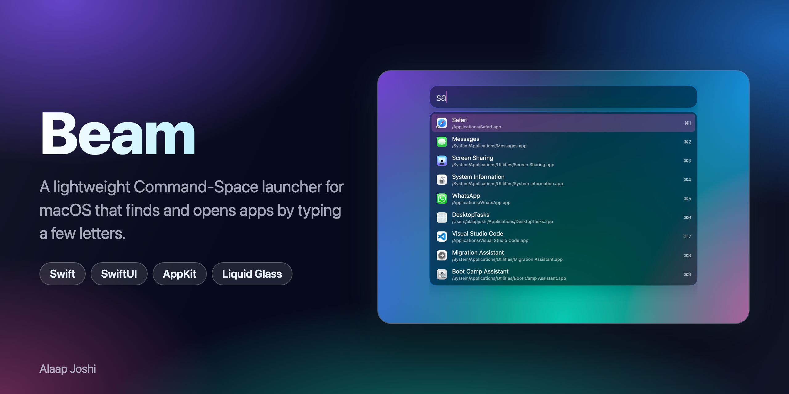
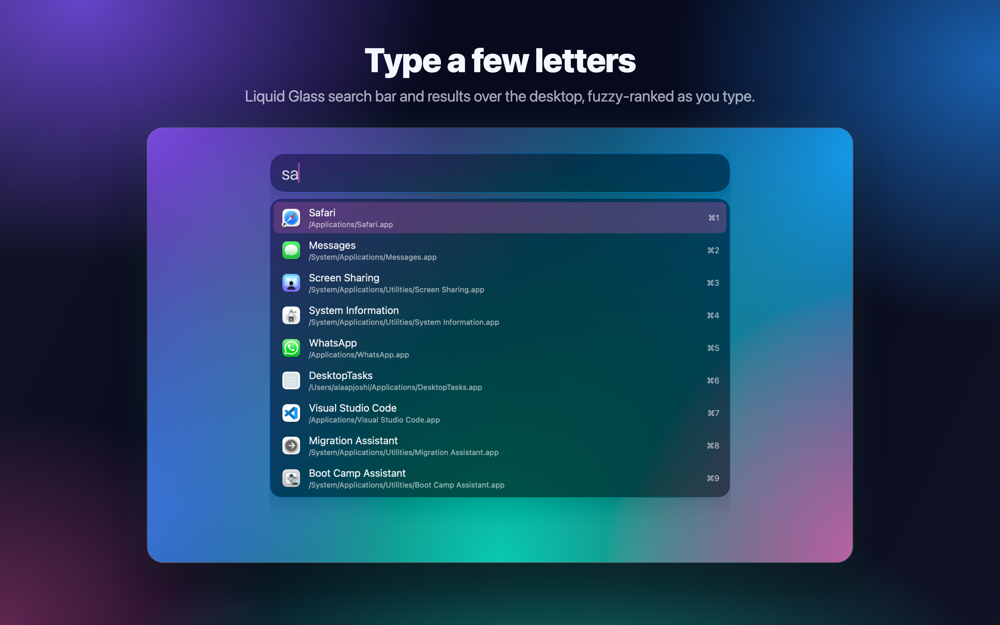
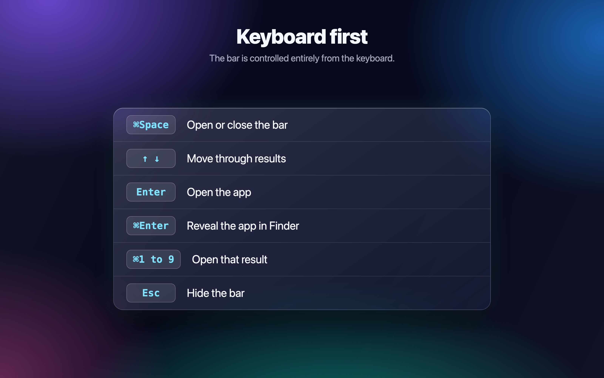
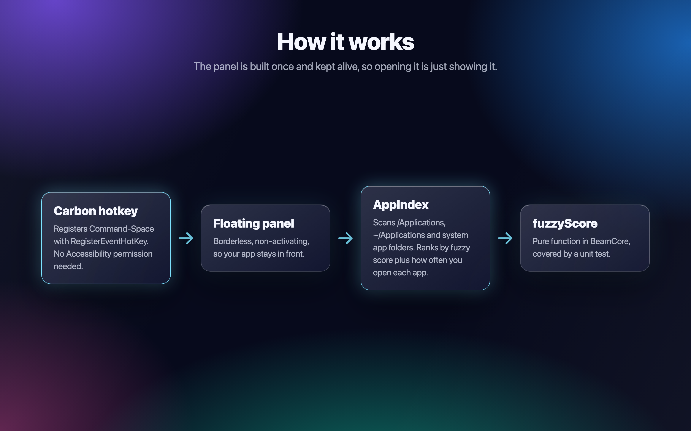
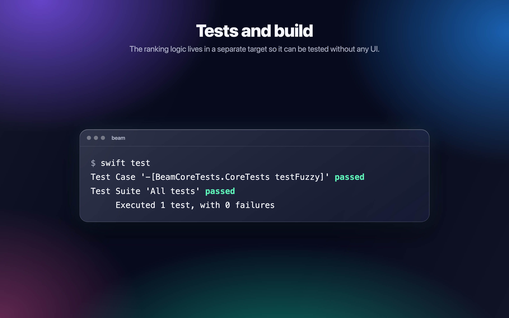

# Beam

> A lightweight Command-Space launcher for macOS that finds and opens apps as you type a few letters.

  

## About

Beam is a native replacement for a heavier launcher: press Command-Space, type, and press Enter. It does one job, launching apps, and leaves out file search, calculators, and plugins on purpose. The search bar is built once and kept alive, so opening it is only ordering a window to the front, and the ranking code lives in its own target (`BeamCore`) so it can be unit tested without any UI.

## Features

- Opens a floating search bar from anywhere with Command-Space, with no Accessibility permission needed.
- Matches apps by fuzzy search, so `vsc` finds Visual Studio Code, and ranks word starts and prefixes highest.
- Ranks apps you open often higher, learning from your use.
- Lets you pick with the arrow keys, Command-1 to 9, or the mouse, and reveal an app in Finder with Command-Enter.
- Indexes /Applications, /System/Applications, their Utilities folders, and ~/Applications, refreshed each time the bar opens.
- Starts at login and runs as a background app with no Dock icon.
- Draws the bar and results in Liquid Glass on macOS 26, and falls back to a standard blur material on macOS 14 and 15.

## Gallery

<table>
  <tr>
    <td width="50%"> Real screenshot: typing sa lists matching apps, with Safari selected</td>
    <td width="50%"> The whole bar is driven from the keyboard</td>
  </tr>
  <tr>
    <td width="50%"> From hotkey to ranked results</td>
    <td width="50%"> swift test on the BeamCore ranking logic</td>
  </tr>
</table>

## Tech Stack

| Layer | Technology |
|---|---|
| Language | Swift 5.10 (SwiftPM, no dependencies) |
| UI | SwiftUI inside an AppKit `NSPanel` |
| System | Carbon `RegisterEventHotKey`, `NSWorkspace`, `SMAppService` (launch at login) |
| Tools | SwiftPM, XCTest, `make`, ad-hoc `codesign` |

## Getting Started

### Prerequisites

- macOS 14 or newer (macOS 26 for the Liquid Glass look; older versions use a blur material)
- Xcode Command Line Tools with Swift 5.10+ (`xcode-select --install`)
- Command-Space must be free: quit Alfred, or turn off Spotlight's shortcut in System Settings, Keyboard, Keyboard Shortcuts, Spotlight.

### Installation

~~~bash
git clone https://github.com/alaapjoshi/beam.git
cd beam
swift test
make install   # builds Beam.app, copies it to /Applications, and opens it
~~~

### Usage

Press Command-Space, type part of an app's name, and press Enter. Esc or clicking elsewhere hides the bar. Use `make run` to try it from the build folder without installing.

To show the bar without the hotkey (for example for a screenshot), launch the app with `BEAM_SHOW_ON_LAUNCH=saf Beam.app/Contents/MacOS/Beam`; the value is the starting query.

If another app already owns Command-Space, Beam shows a dialog that says so.

## Project Structure

~~~text
beam/
  Sources/Beam/        # app: hotkey, floating panel, search view, app index
  Sources/BeamCore/    # fuzzy matching, kept free of UI so it can be tested
  Tests/               # unit tests for the fuzzy ranking
  Resources/Info.plist # bundle info (background app, macOS 14+)
  Makefile             # app, install, run, test, lint, clean
  PLAN.md              # original scope and what was left out
~~~

## How It Works

~~~mermaid
flowchart LR
  Key[Command-Space] --> Panel[Floating NSPanel]
  Panel --> View[SwiftUI search view]
  View --> Index[AppIndex]
  Index --> Fuzzy[fuzzyScore in BeamCore]
  Index --> Launch[NSWorkspace opens app]
~~~

`fuzzyScore` requires the query letters to appear in order in the app name. Matches at the start of a word score 10 each, other letters 1, consecutive letters get +5, and a prefix match adds 50. Shorter names win ties. `AppIndex` adds a small bonus for apps you open often (capped), keeps the top 9, and bumps a usage count in `UserDefaults` when you open one. The panel is a non-activating `NSPanel`, so the app you were using stays in front.

## Future Improvements

- Add a settings option to choose a different hotkey for people who keep Spotlight on Command-Space.
- Show a short "no matches" row instead of an empty bar.
- Add tests for the usage bonus and index refresh.

## Author

**Alaap Joshi** - Computer Science + Cognitive Science, Rutgers University-New Brunswick
[GitHub](https://github.com/alaapjoshi) | [LinkedIn](https://linkedin.com/in/alaapjoshi)

## License

MIT. See [LICENSE](LICENSE).
